# 🚀 Awesome Enterprise AI Orchestration & Workflow Engines

<p align="center">
  
</p>

<p align="center">
  <a href="https://github.com/ishandutta2007/Awesome-Awesome-Awesome"></a>
  <a href="https://discord.gg/jc4xtF58Ve"></a>
  <a href="https://github.com/ishandutta2007/Awesome-Enterprise-AI-Orchestration-Workflow-Engines/stargazers"></a>
  <a href="https://github.com/ishandutta2007/Awesome-Enterprise-AI-Orchestration-Workflow-Engines/network/members"></a>
  <a href="https://github.com/ishandutta2007"></a>
</p>

---

## 📌 Executive Summary & Architecture Blueprint

A curated directory and engineering landscape of **Enterprise AI Orchestration Platforms**, **Durable Workflow Engines**, **Multi-Agent Coordination Frameworks**, and **Distributed AI/ML Infrastructure**. 

Modern production AI architectures require bridging declarative data engineering DAGs, elastic Kubernetes GPU scheduling, high-throughput model inference endpoints, autonomous agent tool loops, and verifiable experiment tracking with enterprise governance and data lineage.

```
       ┌────────────────────────────────────────────────────────┐
       │     🧠 Agentic & Multi-Agent Orchestration Layer       │
       │   (LangGraph · CrewAI · Dify · n8n · AutoGen · Orkas)  │
       └───────────────────────────┬────────────────────────────┘
                                   │ Tool Execution & Sub-tasks
       ┌───────────────────────────▼────────────────────────────┐
       │   ⚙️ Durable Workflow & DAG Pipeline Execution Engine   │
       │  (Temporal · Apache Airflow · Prefect · Dagster · Flyte)│
       └───────────────────────────┬────────────────────────────┘
                                   │ Compute Scheduling & Lineage
       ┌───────────────────────────▼────────────────────────────┐
       │   📈 Model Registry, Experiment Tracking & Governance  │
       │   (MLflow · Weights & Biases · ClearML · Unity Catalog) │
       └───────────────────────────┬────────────────────────────┘
                                   │ Distributed Execution
       ┌───────────────────────────▼────────────────────────────┐
       │  ⚡ Distributed AI Compute & GPU Scheduling Layer       │
       │       (Ray · SkyPilot · Volcano · Kueue · Run:ai)       │
       └────────────────────────────────────────────────────────┘
```

---

## 📑 Table of Contents

- [📊 Sector Overview & Market Dynamics](#-sector-overview--market-dynamics)
- [☁️ Enterprise SaaS & Commercial Platforms](#️-enterprise-saas--commercial-platforms)
- [💻 Open-Source AI Orchestration & Workflow Engines](#-open-source-ai-orchestration--workflow-engines)
- [🎯 Key Architectural Decision Matrix](#-key-architectural-decision-matrix)
- [🛠️ How to Contribute](#️-how-to-contribute)
- [⭐ Star History](#-star-history)
- [💖 Support & Community](#-support--community)
- [⚠️ Disclaimer](#️-disclaimer)

---

## 📊 Sector Overview & Market Dynamics

The global enterprise AI orchestration, MLOps, and workflow automation market is estimated at **$18.5 Billion in 2026**, projected to exceed **$68.2 Billion by 2032** at an accelerating **24.2% compound annual growth rate (CAGR)** as organizations transition from ad-hoc single-prompt LLM prototypes into continuous multi-agent autonomous production systems.

The sector demonstrates **moderate market fragmentation with a dual-tiered competitive dynamic**:
- **Consolidated Cloud & Compute Layer (Winner-Take-Most):** Enterprise compute virtualization, unified data lakehouse governance, and baseline cloud orchestration are heavily concentrated among hyperscalers (Microsoft Azure, AWS, Google Cloud) and specialized GPU cloud ecosystems (Databricks Mosaic AI, CoreWeave / Weights & Biases, NVIDIA / Run:ai).
- **Vibrantly Fragmented Workflow & Agent Application Layer:** The high-level agentic orchestration layer, durable code-as-workflows, and specialized MLOps tooling remain intensely diverse and open-source led (`n8n`, `Dify`, `LangGraph`, `Temporal`, `Apache Airflow`, `Ray`, `Prefect`, `Dagster`, `Flyte`), preventing cloud vendor lock-in through modular plug-and-play abstractions.

---

## ☁️ Enterprise SaaS & Commercial Platforms

*Commercial AI workflow orchestration suites, managed MLOps environments, and GPU cluster management platforms. Sorted in descending order by parent company scale (valuation / annual revenue).*

| Platform | Category & Core Capabilities | Company Scale (Valuation / Revenue) | Starting Paid Tier Pricing | Free Tier & Free Trial Limits |
| :--- | :--- | :--- | :--- | :--- |
| **[Azure Machine Learning](https://azure.microsoft.com/en-us/products/machine-learning/)** | Enterprise MLOps studio, Prompt Flow orchestration, automated model evaluation, and Azure AI foundry integrations. | **Part of Microsoft** (~$3.1T market cap; ~$85B+ Azure annual cloud revenue) | **$0.00 / mo workspace fee**; pay-as-you-go compute (e.g. `Standard_DS2_v2` starts at **$0.096 / hr**) | **$200 Free Azure Credits** (30-day initial trial + 12 months of 55+ free services; Azure ML Studio is free to provision) |
| **[Google Vertex AI](https://cloud.google.com/vertex-ai)** | Unified enterprise AI engine powering Vertex AI Pipelines (managed Kubeflow/TFX), Agent Builder, Model Garden, and distributed GPU fine-tuning. | **Part of Alphabet / Google** (~$2.2T market cap; ~$45B+ Google Cloud ARR) | **$0.03 per pipeline run** + underlying Google Cloud compute (e.g. `e2-standard-4` starts at **$0.134 / hr**) | **$300 Free Cloud Credits** (90-day trial for new accounts + perpetual monthly free allowances on Vertex Search and Cloud Workflows) |
| **[AWS Step Functions](https://aws.amazon.com/step-functions/)** | Serverless visual and code-defined workflow coordinator orchestrating SageMaker pipelines, Amazon Bedrock multi-agent flows, and Lambda microservices. | **Part of Amazon / AWS** (~$2.1T market cap; ~$115B+ AWS annual revenue) | **$0.025 per 1,000 state transitions** (Standard Workflows) or **$1.00 per 1M requests** (Express Workflows) | **Perpetual Free Tier**: **4,000 free state transitions every month** indefinitely across all standard AWS accounts |
| **[Databricks Mosaic AI](https://www.databricks.com/product/machine-learning)** | Complete data intelligence platform featuring Mosaic AI Agent Framework, Unity Catalog data lineage, GPU serving endpoints, and Lakeflow automation. | **$62.0 Billion Valuation** (~$3.0B+ ARR run-rate) | **$0.07 / DBU** (Databricks Unit) for Jobs compute + cloud provider VM infrastructure pass-through | **14-Day Full-Access Free Trial** (Includes complete Mosaic AI workspace capabilities + perpetual Databricks Community Edition) |
| **[MLflow Cloud (Databricks)](https://www.databricks.com/product/managed-mlflow)** | Fully-managed enterprise MLflow server delivering zero-management experiment tracking, centralized model registries, and secure team RBAC. | **Part of Databricks** ($62.0B valuation; ~$3.0B+ ARR) | **$0.07 – $0.15 / DBU** (Included directly across Databricks workspaces) | **Perpetual Free Access via Community Edition**: Free hosted MLflow tracking server paired with a 15 GB micro-cluster |
| **[Dataiku](https://www.dataiku.com/)** | Centralized enterprise AI studio combining no-code visual workflow pipelines, custom Python/R MLOps, LLM Mesh governance, and cost monitoring. | **$3.7 Billion Valuation** (~$250M+ ARR) | **$4,000 / month** minimum indicative starting tier for managed enterprise team plans (custom quote based on compute nodes) | **Perpetual Free Community Edition**: Free full-featured local/server installation for up to **3 named users**; 14-day hosted Cloud trial |
| **[Weights & Biases (CoreWeave)](https://wandb.ai/)** | Leading developer platform for ML experiment logging, hyperparameter sweeps, W&B Weave LLM application tracing, and enterprise model governance. | **Acquired by CoreWeave for ~$1.7B** (part of $23B+ CoreWeave AI Cloud; ~$200M+ ARR) | **$50 / user / month** (Starting price for W&B Pro tier billed annually; custom enterprise volume contracts) | **Perpetual Free Personal Tier**: Unlimited private and public projects with **100 GB artifact storage** included forever |
| **[DataRobot](https://www.datarobot.com/)** | Full-lifecycle predictive and generative AI platform delivering automated feature engineering, LLM guardrails, and real-time production monitoring. | **~$1.5B–$2.0B Est. Valuation** (~$300M+ est. ARR) | **$10,000 / year** indicative entry starting subscription for dedicated workbench licenses (custom enterprise quoting) | **14-Day Free Guided Trial**: Full interactive trial access to DataRobot Workbench, notebook environments, and generative AI sandboxes |
| **[Domino Data Lab](https://www.dominodatalab.com/)** | Hybrid-cloud and multi-cloud enterprise MLOps platform facilitating collaborative reproducibility, self-hosted GPU clusters, and governance. | **~$1.0B Est. Valuation** (~$100M+ ARR; backed by Sequoia Capital and Coatue) | **$1,500 / user / year** starting indicative platform seat subscription + customer-provided compute infrastructure | **Enterprise Sandbox Access**: Free guided proof-of-concept environment and interactive hands-on sandbox upon request |
| **[Run:ai (NVIDIA)](https://www.run.ai/)** | Kubernetes-native dynamic GPU pooling, fractional GPU sharing, and workload queueing software optimizing AI training and high-density inference. | **Acquired by NVIDIA for ~$700M** (~$130B+ NVIDIA parent annual revenue) | **$1,200 / GPU / year** indicative enterprise cluster node licensing fee | **Free Guided Test Drive**: Dedicated hosted virtual sandbox cluster for enterprise infrastructure evaluation; open-source K8s drivers |

---

## 💻 Open-Source AI Orchestration & Workflow Engines

*High-performance open-source workflow orchestrators, multi-agent frameworks, distributed AI execution runtimes, and cluster schedulers. Sorted in descending order by GitHub stargazers count.*

| Repository & Ecosystem | GitHub Stars | Core Focus Area | Architecture & Primary Capabilities |
| :--- | :---: | :--- | :--- |
| **[n8n](https://github.com/n8n-io/n8n)**<br>`n8n-io/n8n` | [](https://github.com/n8n-io/n8n/stargazers) | Visual Workflow Automation & AI Agents | Node-based low-code workflow automation framework with built-in LangChain tools, autonomous agent triggers, and 400+ enterprise connectors. |
| **[Dify](https://github.com/langgenius/dify)**<br>`langgenius/dify` | [](https://github.com/langgenius/dify/stargazers) | LLM Application Development & Visual Agents | Production-grade LLMOps platform combining prompt engineering studios, visual multi-agent workflow DAGs, RAG pipelines, and backend APIs. |
| **[RAGFlow](https://github.com/infiniflow/ragflow)**<br>`infiniflow/ragflow` | [](https://github.com/infiniflow/ragflow/stargazers) | RAG Orchestration & Document Pipelines | Deep document understanding engine and agent-native context pipeline orchestrating complex enterprise document retrieval workflows. |
| **[OpenHands](https://github.com/All-Hands-AI/OpenHands)**<br>`All-Hands-AI/OpenHands` | [](https://github.com/All-Hands-AI/OpenHands/stargazers) | Autonomous Software Engineering Agents | Open-source platform orchestrating autonomous agent loops capable of reading codebases, executing terminal tasks, and creating git commits. |
| **[AutoGen](https://github.com/microsoft/autogen)**<br>`microsoft/autogen` | [](https://github.com/microsoft/autogen/stargazers) | Multi-Agent Conversational Orchestration | Microsoft framework enabling multi-agent conversation choreography, asynchronous actor-based patterns, and complex agent tool collaboration. |
| **[CrewAI](https://github.com/crewAIInc/crewAI)**<br>`crewAIInc/crewAI` | [](https://github.com/crewAIInc/crewAI/stargazers) | Role-Based Autonomous Agent Crews | Intuitive Python framework orchestrating collaborative autonomous AI agents with specialized roles, task delegation, and execution hierarchies. |
| **[LlamaIndex](https://github.com/run-llama/llama_index)**<br>`run-llama/llama_index` | [](https://github.com/run-llama/llama_index/stargazers) | Data Framework & Workflow Orchestration | Context augmentation framework featuring event-driven `llama-index-workflows` for resilient, debuggable multi-agent and RAG state machines. |
| **[Apache Airflow](https://github.com/apache/airflow)**<br>`apache/airflow` | [](https://github.com/apache/airflow/stargazers) | Batch Data Pipelines & Enterprise DAGs | Industry standard programmatic workflow management platform for authoring, scheduling, and monitoring complex data and ML workflows as Python code. |
| **[LangGraph](https://github.com/langchain-ai/langgraph)**<br>`langchain-ai/langgraph` | [](https://github.com/langchain-ai/langgraph/stargazers) | Stateful Multi-Agent Cycles & State Machines | Graph-based orchestration library engineered for building resilient, controllable, stateful multi-actor agent workflows with human-in-the-loop validation. |
| **[Ray](https://github.com/ray-project/ray)**<br>`ray-project/ray` | [](https://github.com/ray-project/ray/stargazers) | Distributed Compute & AI Engine | General-purpose distributed computing runtime accelerating distributed ML training (Ray Train), hyperparameter tuning (Ray Tune), and serving (Ray Serve). |
| **[MLflow](https://github.com/mlflow/mlflow)**<br>`mlflow/mlflow` | [](https://github.com/mlflow/mlflow/stargazers) | MLOps Tracking, Registry & Agent Evaluation | Open-source platform managing the end-to-end machine learning lifecycle, supporting experiment tracking, model registry, prompt evaluation, and PyFunc deployments. |
| **[Temporal](https://github.com/temporalio/temporal)**<br>`temporalio/temporal` | [](https://github.com/temporalio/temporal/stargazers) | Durable Execution & Resilient Workflows | Microservice orchestration system guaranteeing durable execution of long-running, fault-tolerant business workflows and mission-critical AI processes. |
| **[Prefect](https://github.com/prefecthq/prefect)**<br>`prefecthq/prefect` | [](https://github.com/prefecthq/prefect/stargazers) | Modern Python Workflow Orchestration | Modern, Python-native workflow engine allowing developers to transform existing Python functions into dynamic, observable, and failure-resistant pipelines. |
| **[Dagster](https://github.com/dagster-io/dagster)**<br>`dagster-io/dagster` | [](https://github.com/dagster-io/dagster/stargazers) | Software-Defined Data & AI Assets | Declarative orchestration engine built around software-defined assets, data lineage tracking, and robust testing across development and production environments. |
| **[Kubeflow](https://github.com/kubeflow/kubeflow)**<br>`kubeflow/kubeflow` | [](https://github.com/kubeflow/kubeflow/stargazers) | Cloud-Native Kubernetes MLOps Suite | Kubernetes-native platform for orchestrating scalable machine learning pipelines (Kubeflow Pipelines), distributed training (Training Operator), and model serving. |
| **[SkyPilot](https://github.com/skypilot-org/skypilot)**<br>`skypilot-org/skypilot` | [](https://github.com/skypilot-org/skypilot/stargazers) | Multi-Cloud AI & GPU Compute Broker | Framework enabling seamless execution of AI/ML workloads across any cloud (AWS, GCP, Azure, Lambda, RunPod, OCI) while optimizing for spot pricing and GPU availability. |
| **[Metaflow](https://github.com/Netflix/metaflow)**<br>`Netflix/metaflow` | [](https://github.com/Netflix/metaflow/stargazers) | Human-Centric Data Science & ML Framework | Developed by Netflix to empower data scientists to build, prototype, manage, and scale real-world ML projects effortlessly from laptop to the cloud. |
| **[Orkas](https://github.com/Orkas-AI/Orkas)**<br>`Orkas-AI/Orkas` | [](https://github.com/Orkas-AI/Orkas/stargazers) | AI Orchestration & Multi-Agent Pipelines | Native AI orchestration platform built to synchronize enterprise tasks, intelligent agents, and automated computational graphs across self-hosted clusters. |
| **[Flyte](https://github.com/flyteorg/flyte)**<br>`flyteorg/flyte` | [](https://github.com/flyteorg/flyte/stargazers) | Type-Safe Distributed ML Orchestration | Production-grade, type-safe workflow automation engine for mission-critical ML pipelines, data processing, and large-scale parallel task graphs on Kubernetes. |
| **[ClearML](https://github.com/clearml/clearml)**<br>`clearml/clearml` | [](https://github.com/clearml/clearml/stargazers) | CI/CD MLOps & Compute Orchestration | Unified MLOps suite integrating experiment tracking, automatic model logging, dynamic remote compute scheduling, and interactive data management. |
| **[Volcano](https://github.com/volcano-sh/volcano)**<br>`volcano-sh/volcano` | [](https://github.com/volcano-sh/volcano/stargazers) | Cloud-Native Batch & HPC Scheduler | CNCF batch scheduler for Kubernetes tailored for high-performance AI, deep learning, big data (Spark, Flink, TensorFlow, PyTorch), and GPU gang-scheduling. |
| **[ZenML](https://github.com/zenml-io/zenml)**<br>`zenml-io/zenml` | [](https://github.com/zenml-io/zenml/stargazers) | Extensible MLOps & LLM Stacks | Modular pipeline orchestrator connecting arbitrary tools across the ML lifecycle (experiment trackers, orchestrators, annotators, and model registries). |
| **[Kueue](https://github.com/kubernetes-sigs/kueue)**<br>`kubernetes-sigs/kueue` | [](https://github.com/kubernetes-sigs/kueue/stargazers) | Kubernetes-Native Job Queueing & Multi-Tenancy | Kubernetes Special Interest Group (SIG) job queue controller managing resource quotas, priority queuing, and multi-tenant fairness for AI batch workloads. |

---

## 🎯 Key Architectural Decision Matrix

Choosing the right orchestration engine depends fundamentally on workflow statefulness, compute intensity, and latency profiles:

| Architectural Need | Recommended Engines & Frameworks | Key Rationale |
| :--- | :--- | :--- |
| **Cyclic Multi-Agent Collaboration** | `LangGraph`, `CrewAI`, `AutoGen`, `Orkas` | Native support for cyclic state graphs, conversation loops, dynamic tool calling, and human validation gates. |
| **Durable Long-Running Workflows** | `Temporal`, `AWS Step Functions` | Event-sourced durable execution ensures jobs survive infrastructure crashes, network failures, and days-long execution loops. |
| **Data Asset & Pipeline Lineage** | `Dagster`, `Apache Airflow`, `Prefect` | Software-defined assets, rich dependency DAGs, cross-pipeline backfilling, and deep data catalog integration. |
| **Kubernetes Cloud-Native ML Pipelines** | `Flyte`, `Kubeflow`, `Google Vertex AI` | Type-safe task interfaces, containerized task isolation, GPU node pool scheduling, and reproducible pipeline runs. |
| **GPU Cluster Optimization & Scheduling** | `Ray`, `Run:ai`, `SkyPilot`, `Volcano`, `Kueue` | Multi-cloud spot compute arbitrage, dynamic GPU slicing, gang scheduling, and elastic distributed model training. |

---

## 🛠️ How to Contribute

Contributions from platform engineers, ML researchers, and open-source contributors are welcome! 

1. **Fork the repository** to your personal GitHub account.
2. **Create a descriptive feature branch**: `git checkout -b feature/add-engine-name`.
3. **Verify criteria**:
   - For SaaS products: Must include verified starting prices, specific free tier limits, and company scale metrics.
   - For Open-Source repositories: Must be actively maintained, have substantive community adoption, and include a stargazer badge linked to its `/stargazers` page.
4. **Commit your modifications**: `git commit -m "feat: add [Engine Name] to open-source matrix"`.
5. **Push and submit a Pull Request**: Provide a brief explanation of how the tool fits into modern enterprise AI orchestration architectures.

---

## ⭐ Star History

[](https://www.star-history.com/#ishandutta2007/Awesome-Enterprise-AI-Orchestration-Workflow-Engines&type=date&legend=top-left)

---

## 💖 Support & Community

If you find this enterprise orchestration guide and curated architecture index valuable:
- ⭐ **Star this repository** to keep it visible to fellow engineers and architects.
- 🍴 **Fork and share** with your ML platform teams, DevOps organizations, and data engineers.
- ☕ **Support continuous maintenance & updates**: Buy a coffee or sponsor development on the [Sponsor Dashboard](https://github.com/sponsors/ishandutta2007).
- 💬 **Join the community**: Connect with other AI system architects on our [Discord Server](https://discord.gg/jc4xtF58Ve).

---

## ⚠️ Disclaimer

*All product names, logos, brands, and registered trademarks cited in this repository are property of their respective owners. Listing of commercial products or open-source projects does not imply formal endorsement.*
